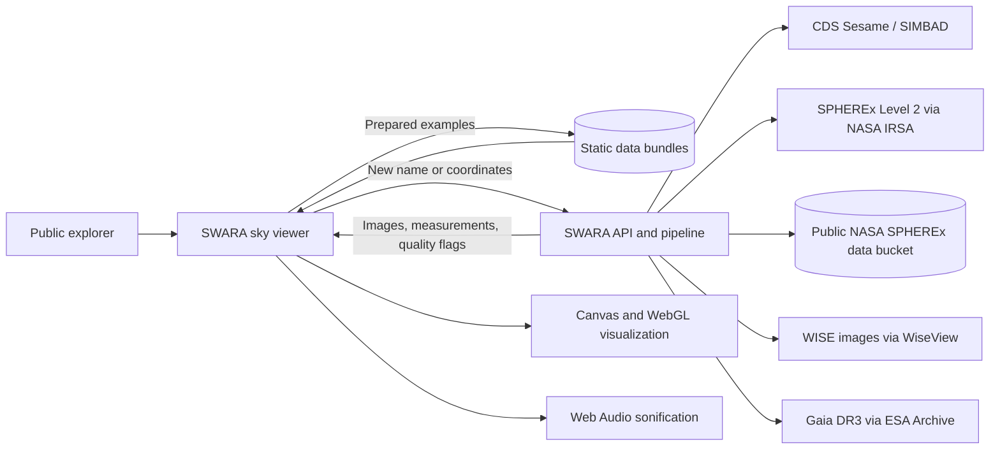

<p align="center">
  <a href="https://swara-nasa.vercel.app/sky">
    
  </a>
</p>

<h1 align="center">SWARA</h1>

<p align="center">
  <strong>Sky Watch with Audio &amp; Real-time Access</strong><br />
  See a patch of sky change across sixteen years. Explore its infrared light by eye or by ear.
</p>

<p align="center">
  <a href="https://swara-nasa.vercel.app/sky"><strong>Open the sky viewer</strong></a> ·
  <a href="https://swara-nasa.vercel.app/sky?target=barnard">Explore Barnard's Star</a> ·
  <a href="https://www.spaceappschallenge.org/2026/challenges/planet-x-and-spherex/">NASA Space Apps Challenge</a>
</p>

<p align="center">
  
  
  
  
  
  
</p>

<p align="center">
  <a href="#the-challenge">The challenge</a> ·
  <a href="#what-swara-does">What SWARA does</a> ·
  <a href="#how-it-works">How it works</a> ·
  <a href="#science-checks-and-limits">Science checks</a> ·
  <a href="#run-locally">Run locally</a>
</p>

> **Hackathon prototype.** SWARA helps people explore public astronomical data; it is not an automated Planet X detector and does not claim new discoveries. The public viewer is free to use without an account or installation.

## The challenge

Since 2025, NASA's SPHEREx mission has mapped the whole sky every six months, collecting data across 102 spectral channels. The archive is powerful, but its files and tools are designed for scientific workflows. It can be hard for a student, teacher, or curious member of the public to compare observations and notice what changed.

SWARA turns a small patch of that archive into an approachable, shareable experience. It brings together SPHEREx observations and the longer WISE record so people can inspect real images, follow measured motion, and listen to a spectrum.

<p align="center">
  
</p>

## What SWARA does

- **Pick a place in the sky.** Search for an object, enter right ascension and declination, or click the all-sky map. Five prepared examples open instantly; a new position can be built from the public archives in about one to one and a half minutes when the services are available.
- **Watch the sky over time.** Browse 13–18 WISE images from 2010–2024, followed by the available SPHEREx visits from 2025–2026. The images are aligned so a nearby star's motion is easier to follow.
- **Inspect SPHEREx visits.** The viewer groups exposures into visits and makes one median image per detector and visit. Blink between visits, inspect the difference from the first visit, and flag saturated or bad pixels.
- **Explore the spectrum.** SPHEREx samples different wavelengths across its exposures. SWARA plots those measurements across approximately 0.75–5 microns and can sonify them: wavelength maps to time and brightness maps to pitch. The sound is a representation of measured data, not a recording of sound in space.
- **Add context.** View Gaia DR3 stars at the date of each image, use the telescope-style zoom, choose a color look, and follow the guided tour.
- **Share an exploration.** Sky positions can be opened from a URL, and share cards summarize an object's measured motion or light.

<p align="center">
  
</p>

## How it works

<p align="center">
  
</p>

1. **Pick a position.** A name is resolved through CDS Sesame/SIMBAD and adjusted using catalog proper motion. Coordinates and map clicks are also supported.
2. **Gather public observations.** The pipeline searches SPHEREx Level 2 images through IRSA, retrieves the needed pixels from NASA's public data bucket, and requests WISE image history through WiseView. Gaia DR3 context is retrieved from the ESA Gaia Archive.
3. **Build comparable views.** Exposures are grouped by visit and detector, aligned to the same sky position, and combined into median images. WISE images provide the earlier time baseline.
4. **Measure and check.** SWARA estimates a position at each visit and compares motion with catalog values. Spectrum points retain quality flags so saturated or bad pixels are visible as limitations.
5. **Explore in the browser.** The viewer animates the images, plots the spectrum, and sonifies the measurements.



<p align="center">
  
</p>

### A note about SPHEREx views

SWARA's six detector views (`D1`–`D6`) are display groupings spanning approximately 0.75–5.0 microns; they are not six fixed filters. SPHEREx wavelength varies across a detector, so measurements from multiple exposures are combined to build the plotted spectrum.

## Science checks and limits

The following examples were measured with SWARA and checked against catalog information where available.

| Target | What SWARA shows | Interpretation |
|---|---|---|
| **Barnard's Star** | 9.9 arcseconds north in one year with SPHEREx; 142.7 arcseconds over 2010–2024 in WISE | Consistent with catalog motion of about 10.4 arcseconds per year and 142.5 arcseconds over the WISE interval |
| **Epsilon Indi B** | 4.8 arcseconds east and 4.0 arcseconds south over about 16 months; 347 clean spectrum points | Main example for exploring and listening to a spectrum |
| **RW Aurigae** | Brightness changes at 4–5 microns between visits | Most spectrum points are flagged as saturated, so this change needs caution |
| **WISE 0855−0714** | Motion appears in WISE images; the SPHEREx source is blended with a background star | SWARA does not claim a separate SPHEREx detection of WISE 0855 |
| **R Draconis** | Detector saturation prevents a valid measurement | Shown as an example of when the data cannot support a result |

Additional SPHEREx cross-checks include Wolf 359 (3.9 arcseconds west and 2.4 arcseconds south in 381 days) and Teegarden's Star (5.2 arcseconds in 12 months), both consistent with catalog motion.

**Important limits:**

- SPHEREx pixels are 6.15 arcseconds across. Motion of only a few arcseconds per year is around one pixel, so measured shifts need to be interpreted with that scale in mind.
- Each target currently has only three or four SPHEREx visits. WISE provides the longer time baseline; its images are for visualization, not precision photometry.
- Bright sources can saturate. SWARA carries quality flags through the images and spectrum; some flagged measurements may be unreliable or unavailable.
- The sonification mapping has been checked numerically, but it has not yet been evaluated in a listening study with blind or low-vision users.
- A new position depends on external archive availability and typically takes about one to one and a half minutes to build. The prepared examples are static files and do not require the API.
- SWARA is an exploration tool, not an automated candidate classifier, a confirmed discovery pipeline, or a replacement for IRSA's research tools.

## Data sources and technology

| Source | How SWARA uses it |
|---|---|
| [NASA/IPAC Infrared Science Archive (IRSA)](https://irsa.ipac.caltech.edu/Missions/spherex.html) | SPHEREx Level 2 image search and documentation |
| [NASA SPHEREx public data on AWS](https://irsa.ipac.caltech.edu/cloud_access/) | Pixel data read by the pipeline |
| [WISE / NEOWISE at IRSA](https://irsa.ipac.caltech.edu/Missions/wise.html) and [WiseView](http://byw.tools/wiseview) | WISE W2 time-series images |
| [CDS Sesame](https://cds.unistra.fr/cgi-bin/Sesame) and [SIMBAD](https://simbad.cds.unistra.fr/) | Resolve object names and catalog coordinates/proper motion |
| [ESA Gaia Archive](https://gea.esac.esa.int/archive/) | Gaia DR3 stars overlaid at the date of each image |

| Layer | Technologies |
|---|---|
| Data pipeline and API | Python 3.12, Astropy, NumPy, Pillow, HTTPX, fsspec, aiohttp, FastAPI, Uvicorn, `uv` |
| Web viewer | React 19, TypeScript, Vite, Canvas 2D, WebGL, Web Audio API |
| Sky map and interface | HEALPix libraries, Driver.js, Phosphor Icons, Archivo, IBM Plex Mono |
| Hosting | Vercel for the public web app; a small Linux service for the coordinate-search API |

## Run locally

**Requirements:** Node.js 24.x, Python 3.12, and [uv](https://docs.astral.sh/uv/).

```bash
git clone https://github.com/wildanniam/SWARA-NASA.git
cd SWARA-NASA
# Terminal 1 — from the repository root
cd web
npm ci
npm run dev
```

Open [http://localhost:5183](http://localhost:5183). Prepared examples work without the API. To search new object names or coordinates, start the API in a second terminal:

```bash
# Terminal 2 — from the repository root
cd pipeline
uv sync
uv run skychange serve
```

The viewer's development server forwards `/api` requests to the local API. See [pipeline/README.md](pipeline/README.md) for the API, coordinate formats, bundle structure, and data pipeline details.

## Repository layout

| Path | Contents |
|---|---|
| [`web/`](web/) | React sky viewer, landing page, sonification, and visual design notes |
| [`pipeline/`](pipeline/) | `skychange` Python package for archive search, image processing, spectrum extraction, and API |
| [`bundles/`](bundles/) | Prepared example observations and the all-sky map used by the viewer |
| [`deploy/`](deploy/) | Service configuration for the API |
| [`LICENSE`](LICENSE) | GNU Affero General Public License v3.0 or later |

## AI use and license

The idea, product direction, science decisions, and final review belong to the SWARA team. AI coding assistants helped write and review code and documentation under the team's direction.

SWARA is free software under the [GNU Affero General Public License v3.0 or later](LICENSE). Data providers and third-party libraries retain their own terms. See their linked source pages and package metadata for details.

